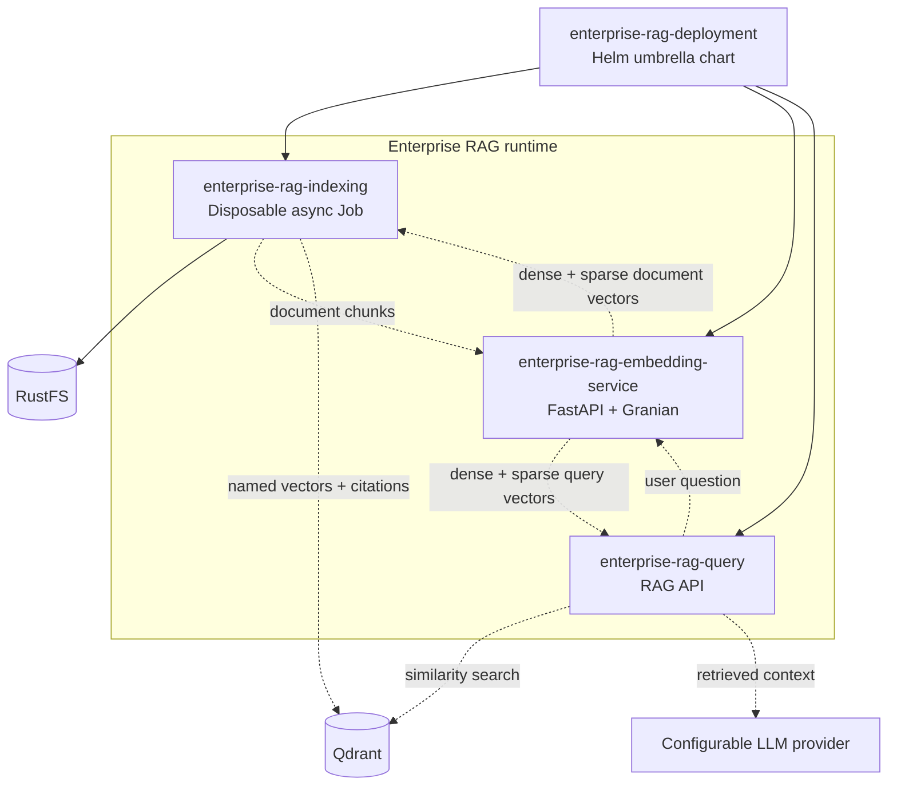
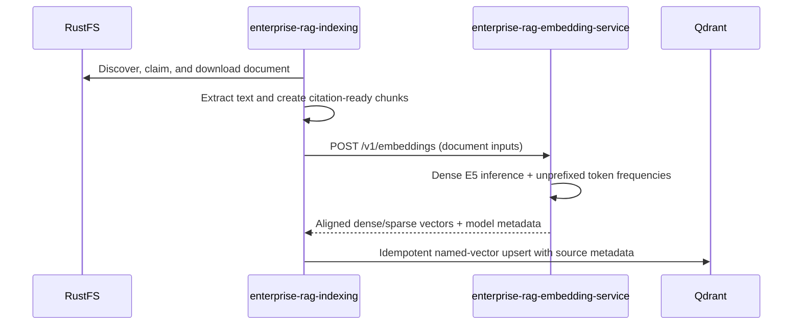
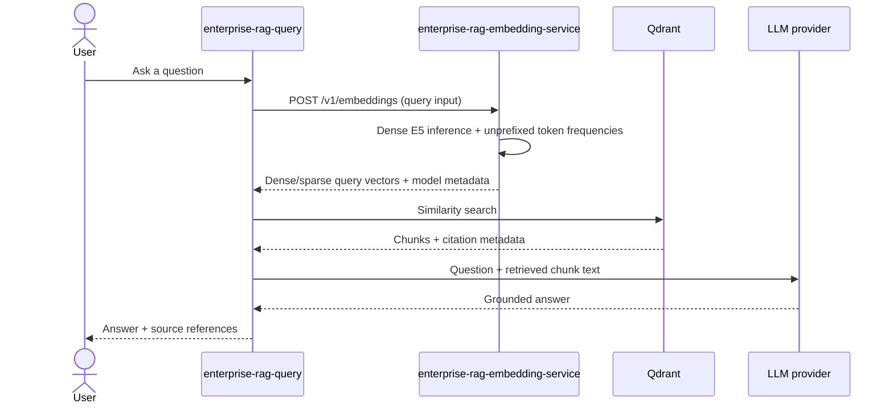
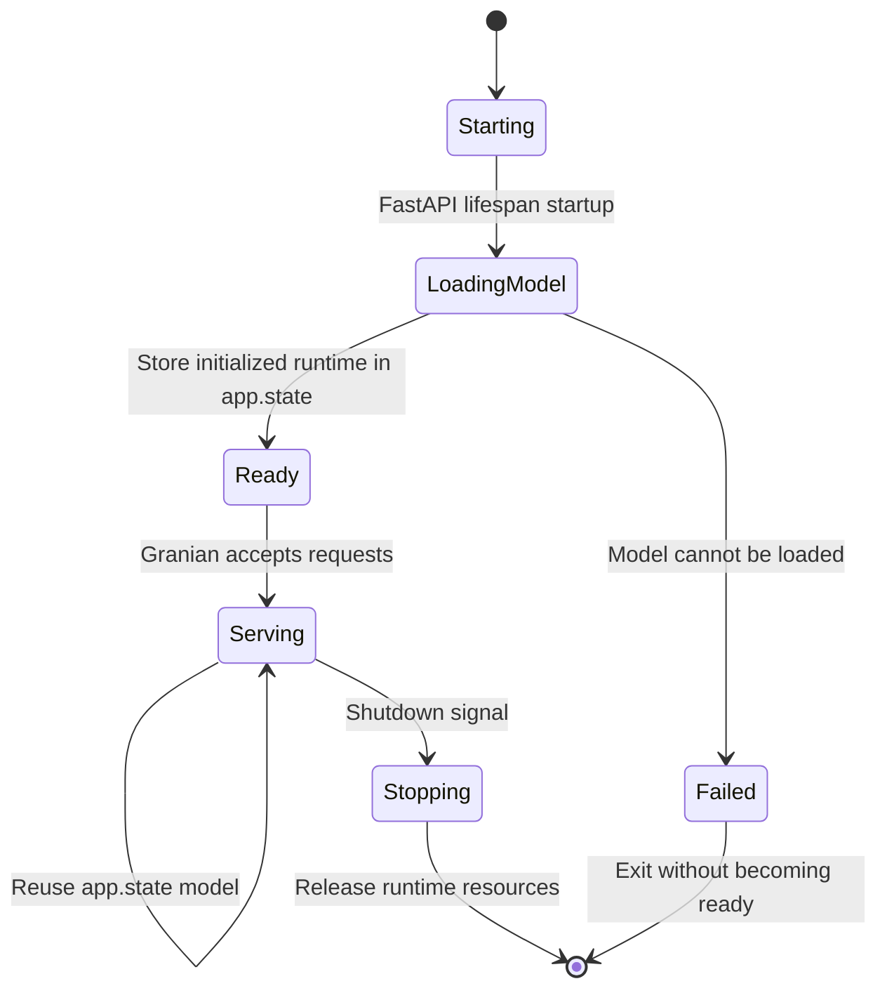

# Enterprise RAG Embedding Service

> **Status: embedding service implemented for local development.** The service synchronizes model artifacts from RustFS at startup, loads the ONNX runtime, and serves dense and sparse document/query embeddings. Indexing consumes both representations; Kubernetes deployment remains separate work.

`enterprise-rag-embedding-service` is the shared vectorization component for Enterprise RAG. It loads one configured embedding model per application process and exposes a versioned HTTP API used by document indexing and question answering.

The service exists to prevent indexing and query applications from implementing model-specific tokenization, prefixes, pooling, normalization, and vector dimensions independently.

Authentication (authn) and authorization (authz) are outside the scope of this project and are not implemented or covered by this service.

## Responsibilities

The service will:

- Accept batches of document chunks from `enterprise-rag-indexing`.
- Accept user questions from `enterprise-rag-query`.
- Apply the correct model-specific input preparation. For `intfloat/multilingual-e5-small`, document chunks use `passage:` and questions use `query:`.
- Tokenize inputs, run bounded inference, pool token embeddings, and normalize output vectors consistently.
- Return aligned dense and token-frequency sparse vectors together with dense/sparse model identity, pinned revision, dimension, and normalization metadata.
- Load the configured model once during FastAPI lifespan startup and reuse it across multiple requests through `app.state`.

The service will not:

- Discover or download source documents from S3/RustFS.
- Extract PDF text or chunk documents.
- Persist document vectors to Qdrant.
- Search Qdrant or rerank results.
- Construct prompts or call an LLM.
- Embed retrieved context during question processing. The query service embeds the user's question, then uses retrieved chunk text as LLM context.

## Component relationships

All application components remain separate repositories tracked as Git submodules by the root `enterprise-rag` orchestration repository. Dashed arrows represent service boundaries or persistence work owned by another component.



### Indexing flow



### Query flow



## Application lifecycle

The service will use FastAPI's lifespan mechanism rather than loading the model in a request handler.



One loaded runtime is shared by requests handled within the same application process. If Granian is configured with multiple worker processes, each worker will have its own `app.state` and therefore its own model instance; worker count must be chosen with memory usage in mind.

The application will expose separate liveness and readiness endpoints. Liveness reports process health. Readiness succeeds only when the model runtime stored in `app.state` is available for inference.

## REST contract

The first API version uses `POST /v1/embeddings`.

The running service provides interactive and machine-readable API
documentation:

- Swagger UI: <http://localhost:8081/docs>
- ReDoc: <http://localhost:8081/redoc>
- OpenAPI JSON: <http://localhost:8081/openapi.json>

The generated contract includes request and response examples, field
descriptions, health endpoints, documented error statuses, and stable operation
IDs. See [OpenAPI and interactive API documentation](docs/openapi.md).

```json
{
  "input_type": "document",
  "texts": [
    "First citation-ready document chunk",
    "Second citation-ready document chunk"
  ]
}
```

`input_type` is required and will accept `document` or `query`. Clients send chunks as document inputs and user questions as query inputs. They do not add model prefixes themselves.

The response is:

```json
{
  "model": "intfloat/multilingual-e5-small",
  "revision": "pinned-model-revision",
  "dimension": 384,
  "normalized": true,
  "embeddings": [
    [0.012, -0.034, 0.056]
  ],
  "sparse_model": "multilingual-e5-token-frequency-v1",
  "sparse_embeddings": [
    {
      "indices": [1019, 2788, 16347],
      "values": [1.0, 2.0, 1.0]
    }
  ]
}
```

The displayed vectors are abbreviated. Dense inputs receive the model's
`passage:` or `query:` prefix. Sparse inputs intentionally remain unprefixed;
the shared tokenizer emits stable token IDs and positive term frequencies,
while Qdrant supplies corpus-level IDF. Batch size and total input characters
are bounded by validated configuration.

### `curl` examples

Vectorize a user question by sending it as a `query` input:

```bash
curl -X POST http://localhost:8081/v1/embeddings \
  -H "Content-Type: application/json" \
  -d '{
    "input_type": "query",
    "texts": [
      "What are the contract termination conditions?"
    ]
  }'
```

Vectorize one or more document chunks by using `document` input:

```bash
curl -X POST http://localhost:8081/v1/embeddings \
  -H "Content-Type: application/json" \
  -d '{
    "input_type": "document",
    "texts": [
      "The agreement may be terminated with thirty days written notice.",
      "Termination does not affect obligations that accrued before the termination date."
    ]
  }'
```

The response contains one normalized dense vector and one sparse vector per
input string. Callers must not add model prefixes themselves.

## Architecture

Application code will live under `app/` so it is placed at `/app/app` in the container. The initial layout will follow the project-wide Clean Architecture conventions:

```text
enterprise-rag-embedding-service/
├── app/
│   ├── common/
│   │   ├── settings/          # Pydantic BaseSettings groups
│   │   └── utility/           # Reusable non-business helpers
│   ├── repository/                # Model storage/runtime adapters
│   ├── usecases/                  # Embedding application behavior
│   ├── controllers/               # Coordination where needed
│   ├── middleware/                # UnhandledExceptionMiddleware
│   ├── api/                       # Versioned FastAPI routes and models
│   └── main.py                    # Composition and lifespan startup
├── Dockerfiles/
│   └── enterprise-rag-embedding-service
├── docs/                              # MkDocs documentation after code exists
├── tests/
├── requirements.txt
└── README.md
```

FastAPI will be served by Granian. The image entrypoint will use `dumb-init` for signal forwarding and cleanup. Provider-specific model storage and inference implementations will remain behind repository contracts and will be constructed in the application composition layer.

`UnhandledExceptionMiddleware` logs unexpected errors with their causes and returns sanitized `422`, `503`, or `504` responses according to the failure category. It does not expose stack traces, local paths, credentials, full input texts, or vectors to API clients.

## Configuration

The root orchestration repository owns the service's local environment files:

- Safe template committed to Git: `dev-envs/enterprise-rag-embedding-service.env.example`
- Real Git-ignored configuration: `dev-envs/enterprise-rag-embedding-service.env`

The Compose service will use the real file through `env_file`. Configuration names will be finalized with their Pydantic `BaseSettings` classes. Expected groups include:

- API host, port, log level, worker count, and request limits.
- Model name, pinned revision, local directory, runtime, maximum token length, and inference concurrency.
- S3-compatible endpoint, credentials, region, addressing style, TLS verification, model bucket, and model key prefix used to synchronize artifacts from RustFS.

Credentials use secret-aware settings types and are never written to logs. The current development model location is `s3://models/embeddings/intfloat/multilingual-e5-small/`, synchronized to `/models/embedding/intfloat/multilingual-e5-small`.

## Docker and deployment behavior

The dedicated Dockerfile is located at `Dockerfiles/enterprise-rag-embedding-service`. The root `docker-compose.yaml` now defines a long-running development `enterprise-rag-embedding-service` scaffold with:

- Its dedicated root `dev-envs` file.
- A development bind mount for application source.
- A model-artifact volume when local model storage is required.
- A health check that uses the readiness endpoint.
- A dependency on the shared `enterprise_rag_base` build service.

The Compose service synchronizes model artifacts and loads the ONNX runtime
before readiness. Indexing consumes both returned representations. Query
currently consumes the dense representation and safely ignores the additional
sparse response fields until hybrid retrieval is implemented there.

In Kubernetes/OpenShift, `enterprise-rag-deployment` will provide a dedicated embedding-service subchart containing a Deployment and internal Service. The indexer Job/CronJob and query Deployment will call that Service. Resource requests/limits and worker count must account for the memory consumed by each model instance.

## Validation and remaining work

Unit tests will cover:

- Pydantic request, response, and settings validation.
- Document versus query prefix preparation.
- Tokenization, pooling, and normalization using deterministic fixtures.
- Batch and input limits.
- Concurrency bounds.
- Lifespan model initialization and cleanup.
- Startup failure and readiness behavior.
- Sanitized unexpected-error responses.
- Repository factory routing and dependency injection.

Model storage and real-runtime checks will remain separate integration tests. End-to-end validation will verify that document vectors produced for indexing and query vectors produced for retrieval use the same model revision, dimension, and normalization rules.

Once Python implementation code exists, this repository must include MkDocs with generated API references and pass `mkdocs build --strict`. Root Compose configuration must also pass `docker compose --profile dev config` after the service is introduced.

## Current limitations

- Health endpoints and `/v1/embeddings` are implemented for local development.
- Model artifacts are downloaded from the configured RustFS prefix during startup.
- Document and query embedding vectors are generated through `/v1/embeddings`.
- A Dockerfile and development Compose service exist for local inference.
- No Helm embedding-service subchart exists.
- The indexer and query consumers do not yet use this service automatically.
- The example request and response define the current `/v1` contract; incompatible changes should result in a new API version.
